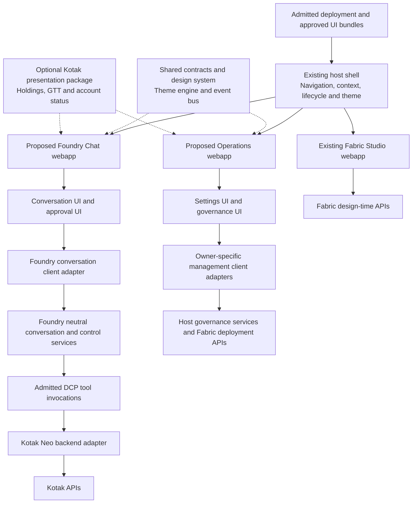
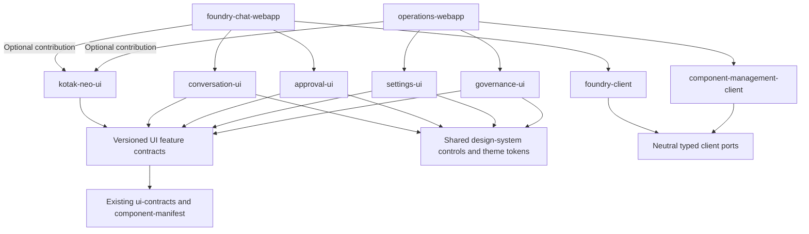
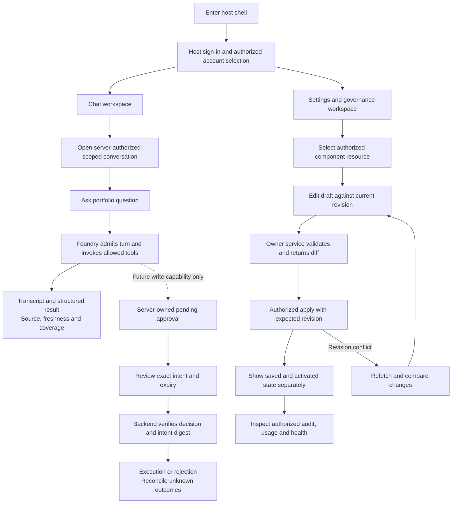

# Reusable chat and settings experiences

Status: proposed design only, 17 October 2026. No new packages, routes, manifests,
API endpoints or backend capabilities are implemented by this change.

## Purpose and decision

Extend `unfurl-ui` with reusable feature packages and independently mountable product
apps for conversations, settings, approvals and governance. Keep Kotak broker logic
in its adapter repository. An optional Kotak presentation package contributes domain
views without owning conversation execution or global administration.

This extends [the host-shell HLD](HLD-D-fabric-ui-host-shell.md), not a replacement
shell or a new general-purpose UI repository. Preserve standalone/hosted webapp
independence, shared contracts, host-mediated communication and separate themes.
Fabric Studio remains a design-time composition app. Runtime chat must not reuse
Studio's authoring endpoint as a general conversation backend.

## Existing foundation and gaps

The workspace already contains `host-shell`, `fabric-studio-webapp`, `ui-contracts`,
`component-manifest`, `event-bus`, `theme-engine` and `design-system`. Host props carry
tenant/user display context, token acquisition, API bases, theme and event bus.
The registry validates manifests, compatibility and navigation permissions.
The current design-system source provides token types, not a complete component kit.

The current manifest supports app navigation, import maps and theme contributions.
It does not define conversation cards, settings sections or approval renderers.
New extension contracts and backend management operations are prerequisites. Browser
permissions and route/query tenant values remain untrusted inputs to the backend.

## Component architecture

This is a proposed logical view. Arrows do not assert endpoint availability or require
a process per box. Browser chat need not traverse ACP or the Codex app-server profile;
those remain optional client protocol adapters. Product wire types stay in client
adapters, not generic presentation packages.

## Package and ownership model

| Proposed unit | Owns | Must not own |
| --- | --- | --- |
| `packages/conversation-ui` | Transcript, composer, history, item/tool states and reconnect presentation | Provider SDKs, broker APIs or execution scheduling |
| `packages/approval-ui` | Exact intent review, pending/expired/conflict states | Grant issuance, approval verification or policy decisions |
| `packages/settings-ui` | Forms, validation presentation, revision conflicts and secret-reference fields | Secret retrieval or arbitrary administration endpoints |
| `packages/governance-ui` | Audit timeline, usage, budgets, health and evidence navigation | Audit persistence, billing settlement or enforcement |
| `packages/foundry-client` | Typed neutral conversation/control client and transport adaptation | ACP/Codex wire types in generic UI components |
| `packages/component-management-client` | Typed host-side management ports and adapters selected by ownership | A fabricated universal backend service |
| `packages/kotak-neo-ui` | Domain renderer registrations and account-settings presentation | Credentials, HTTP headers, raw broker client or trade submission bypass |
| `apps/foundry-chat-webapp` | Composition of conversation features and domain renderers | Imports from Operations or Studio app internals |
| `apps/operations-webapp` | Settings navigation and governance workspace | Hardcoded configuration ownership for every provider |

Existing packages remain the shared foundation. Packages never import app code;
apps do not import each other's internals. The Kotak package is optional and excluded
from dependency closure when unselected. Start as coordinated workspace packages;
extract a repository only for independent release, licensing or ownership needs.

## Contribution model and DCP alignment

### Proposed package dependencies

Arrows indicate allowed dependency direction, not service calls. New feature
contracts extend existing contract packages rather than creating a second manifest
authority. Domain components consume shared contracts and controls without importing
either product app. This view is proposed and does not assert these packages exist.

Use a versioned UI feature descriptor alongside the existing webapp manifest. It
references component identity, compatible host API version, renderer IDs and schemas,
settings resources and management contract references. It is presentation metadata,
not a new DCP core field or executable authority. Generate common operation/schema
identities from the owning component definition when available. Validate references
against admitted deployment capabilities before exposing interactive actions.

The shell may mount an entire app; a chat or console app may compose narrow features
from a host-approved registry. Do not conflate app lifecycle with a per-message
renderer. Only installed, trusted, version-pinned modules execute. Model output,
broker responses and manifests from unauthenticated users cannot supply bundle URLs,
HTML, component code or executable schemas. Shared same-origin modules are trusted
code and not a security sandbox; untrusted extensions require a separately designed
isolated frame/origin and message protocol, outside this initial scope.

## User experiences

Chat shows active account, conversation history and structured evidence together.
Tool results display source, collection time, market-time availability and coverage.
State distinguishes submission pending, running, waiting for input/approval,
cancel requested, completed, failed and outcome unknown as supported by the server.
Loading history does not replay work. Changing account never reuses the prior
account's conversation scope implicitly. Start a new scoped conversation or invoke
an explicitly supported server-side transition.

Operations separates personal preferences, account connections and administrative
configuration. Component-owned sections include session health, provider/model
selection, grants, budgets, audit/telemetry bindings and retention where corresponding
management APIs exist. Show unsupported/unbound controls explicitly and do not fake
saves. Config changes use server validation and revisions; admitted runtime-binding
changes go through the owning deployment/admission lifecycle rather than mutating
a running signed contract from a form.

Future trade review shows exact account, exchange/instrument, side, quantity, order
type, price, trigger, validity, expiry, policy and intent digest. Editing invalidates
the old approval. A button requests a backend decision; it never manufactures an
approval token or promotes a chat instruction into trading authority.

## Security and operations

### Proposed user journeys and backend gates

All journeys are proposed UI behavior gated by real backend support. The first Kotak
slice follows the read path only. Approval and settings controls remain unavailable
when their owner service or admitted capability is absent. Switching account clears
the old view and re-establishes server-authorized scope before any further request.

Backend identity, tenant ownership, account grants and contract admission are mandatory
on every request and stream reconnect. UI guards improve usability only. Keep tokens
ephemeral, out of local storage, URLs, event bus and logs. Never expose broker
credentials through generic settings forms. Session provisioning/renewal uses an
explicit supported host handoff, with status returned to the UI.

Treat tool results and model text as untrusted. Sanitize markdown, disallow raw HTML,
restrict outbound URLs and disable model-specified actions. Keep account data out of
analytics by default. Enforce CSP and bundle allowlists. Cross-tenant tests must cover
history, audit, settings, exports, cached views, streams and deep links.

Scope all state/cache keys by authenticated tenant, principal, account where applicable,
thread/resource and revision. Clear account data and subscriptions on identity change,
logout or unmount. Provide accessible keyboard flows, focus restoration, responsive
tables and text/status alternatives; 3D rendering must never be required for chat or
administration. Themes supply appearance rather than domain packages overriding globals.

## Kotak first slice and delivery boundary

The first domain contribution presents the three delivered reads: holdings, MTF
holdings and GTT listing. It includes quality indicators and externally managed session
status where an authorized host management API exists. There is no buy/sell, GTT write,
live quote, market-cap enrichment or automatic renewal control until its backend gate
is met. Account valuation and market capitalization are separate concepts.

See the [LLD](LLD-reusable-runtime-experiences.md) for extension and interaction
contracts and the [build plan](REPO-reusable-runtime-experiences-build-spec.md) for
dependency-ordered delivery and acceptance. Backend contracts remain owned by Foundry,
Fabric, host governance services and the adapter, not this UI workspace.
