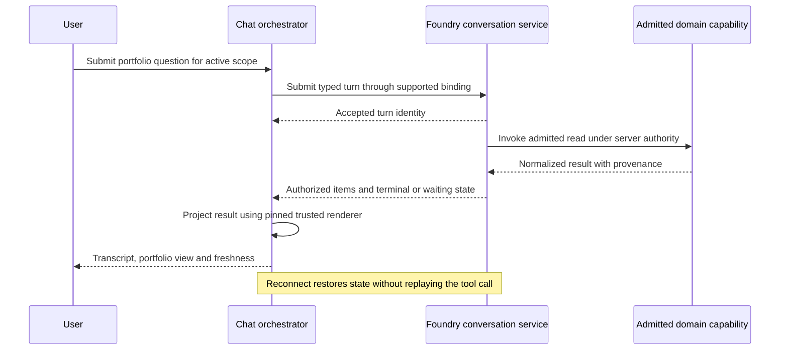

# Reusable runtime experience contracts

Status: proposed design only. [HLD](HLD-reusable-runtime-experiences.md) governs
ownership; [build plan](REPO-reusable-runtime-experiences-build-spec.md) governs
delivery. Names below are proposed interfaces, not installed APIs or DCP enum values.

## Extension registry

Extend `component-manifest` and `ui-contracts` through a versioned companion feature
descriptor, keeping existing manifests valid. A host without the required feature
API rejects the contribution with an explicit compatibility error. It must not import
an incompatible bundle and hope for runtime compatibility.

| Descriptor field | Meaning and validation |
| --- | --- |
| `schemaVersion`, `featureApiRange` | Supported descriptor version and host feature API compatibility |
| `componentRef`, `contributionId`, `version` | Exact owning component identity and unique contribution identity |
| `moduleKey`, `exportName` | Export in a host-controlled import map, never an arbitrary response URL |
| `kind` | Proposed `result-renderer`, `settings-section`, `approval-review` or `governance-view` |
| `contractRefs`, `operationRefs` | References resolved against the admitted deployment, not capability grants |
| `dataSchemaRef`, `dataSchemaDigest` | Pinned bounded schema for displayed payload or resource |
| `placement`, `displayPermissionHints` | Allowlisted slot and visibility hints, not backend authorization |

Build registry entries by validating descriptor shape, duplicate IDs, owner, import
allowlist, export presence, version ranges, schemas and deployment references before
activation. Fail the affected contribution atomically with a diagnostic. Mounting
another app must remain possible. An unavailable domain renderer may show a generic
bounded, schema-safe result view explicitly labeled as such; never fabricate content
or substitute a different operation. Approval review cannot use an incomplete fallback:
disable approval when required intent fields or schema support are missing.

Renderer inputs contain a validated result envelope, provenance, execution reference
and callbacks for explicitly registered intents. They contain no token getter, secret
value or arbitrary request client. The app orchestrator owns client calls. Do not
select a renderer from model-written markdown. Resolve by admitted operation and
pinned schema, with one deterministic match or explicit ambiguity rejection.

Use Adapter for transports, Registry for approved contributions, Strategy for domain
renderers, Projector for neutral view models and Factory for host-scoped wiring.
Do not create an unrelated DCP contract compiler in TypeScript presentation code.

## Conversation service port

`ConversationClient` conceptually supports list/create/read threads, submit/read turns,
read paged items/events, respond to an interaction and request cancellation only when
the selected Foundry binding supports each operation. Map to the actual neutral
conversation API and remote binding before implementation; no route names are declared
here. Use capability discovery to label absent services as unavailable.

Requests carry opaque thread/turn/item references, typed input and a submission key
where the server contract provides idempotency. The authenticated server resolves
tenant/principal/account scope. Responses preserve server identifiers, monotone sequence
or revision, pagination cursor and terminal/control status. Keep client submission ID,
RPC request ID, turn ID, physical tool attempt ID and approval ID distinct.

Load an authorized history snapshot and its high-water mark, then consume events from
that point. Deduplicate by server event identity; reject gaps or out-of-order revisions
and obtain an authorized resnapshot. Bound pages, bytes, items and pending stream queue.
If no resumable stream contract exists, use explicitly supported read polling rather
than inventing an event cursor. Disconnect does not cancel accepted server work.

Never blindly retry an uncertain submit. Query by a supported submission key or turn
reference; otherwise show outcome unknown and offer reconciliation. Cancellation is
a request until the server confirms terminal state. A streaming completion marker
must not conceal pending approvals or tool uncertainty. History load is read-only.

## Settings and management ports

`ComponentManagementClient` is an injected interface, not a new central service.
Its owner-specific implementations support resource discovery, read with revision,
validate draft, apply with expected revision and read operation status where provided.
Persisted field/schema definitions come from an authenticated owner service and an
approved schema vocabulary. Reject arbitrary executable validators or external refs.
Implement finite size/depth and field allowlists.

| Resource class | Authority | Apply behavior |
| --- | --- | --- |
| Personal theme/density | Host preference service | Scoped revisioned preference save |
| Account/session health | Host account/session service | Read status and initiate supported external handoff, never retrieve broker secrets |
| Account grant | Host authorization service | Authorized audited grant change, possibly separate approval |
| Runtime binding or provider profile | Owning deployment control plane / Fabric | Validate proposal and execute explicit rebind/redeploy/admission lifecycle |
| Budget | Host cost enforcement service | Atomic revisioned update with authorized ceilings |
| Audit/telemetry/retention | Owning governance service | Validate destination and policy, audited change and explicit activation state |

Secret fields show `configured`, `missing`, `expired` or `rotation required` status.
Use references or a dedicated host-owned provisioning surface. Generic CRUD cannot
read back secret values. Host templates select approved destinations; user text does
not become arbitrary server-side network access.

Draft state transitions: clean, editing, validating, invalid, ready, applying, applied,
conflict, failed and outcome unknown. Server validation may normalize values and
return a reviewed diff. Any edit invalidates that validation. On revision mismatch,
refetch and show a field-level comparison; never silently overwrite. On ambiguous
apply, read operation status instead of resubmitting. Distinguish saved configuration
from activated runtime state. Mark pending restart, re-admission or rollback failure.
Multi-resource saves are not atomic unless the owning API explicitly guarantees it.

## Approval and governance ports

`ApprovalClient` reads the authorized pending interaction and submits the user's
decision against its revision, expiry and immutable intent digest. Foundry/host
verifies approver rights, separation-of-duties policy and exact parameters. Browser
checkboxes and domain renderer callbacks cannot grant authority. Approval responses
must reference the server-owned pending interaction, not a free-form prompt.

`GovernanceReadClient` exposes authorized bounded queries for audit, usage, health and
budget status. Export uses an authorized server job with scoped expiring retrieval.
No unrestricted SQL, SIEM query or Grafana administrator token enters the browser.
Present estimate versus settled cost, currency, rate version, time window, coverage
and data lag. Missing values display unavailable rather than zero.

Audit UI actions through owning services: settings proposals/applications, grant and
budget changes, approvals, exports and sensitive evidence access. General UI telemetry
contains operation class, safe outcome and latency, without prompts, portfolio rows,
credentials or account identifiers as metric labels. Route notifications through host
ports; component packages do not hardcode vendors.

## Kotak contribution contract

Proposed renderer IDs cover holdings, MTF holdings and GTT instruction lists, each
mapped to the adapter's exact operation/schema version. Preserve original rows,
unknown/zero-cost markers, exchange/instrument identity and coverage. Use decimal
formatting with explicit currency. Collected time is not market time. Do not sum
duplicate instruments or infer live valuation without an approved method.

The account section shows logical account alias and host-provided session status.
It never exposes UCC, SID, auth headers, MPIN or TOTP through generic display data.
Account switching clears cached rows and requires server-authorized scope. GTT status
cards distinguish instruction ID from order/fill identity. All mutation action
registrations are absent until their backend claims, approvals and reconciliation
are delivered and admitted.

## Failure and lifecycle acceptance

Test disabled/unknown contributions, incompatible versions, schema mismatch, duplicate
IDs and untrusted module keys. Unmount cancels UI subscriptions and fetches, not
accepted backend work. Late events from an old identity generation are discarded.
Per-resource revisions and per-thread sequences prevent stale state replacement.
Session expiry triggers host reauthentication without exposing broker secrets.

All views need accessible names, keyboard interaction, focus after dialogs, text
statuses, responsive overflow handling and localization-ready formatting. Error
boundaries isolate feature failures while displaying explicit unavailable states.
Standalone mode constructs the same ports through a trusted bootstrap and must not
ship an allow-all development identity in production.
